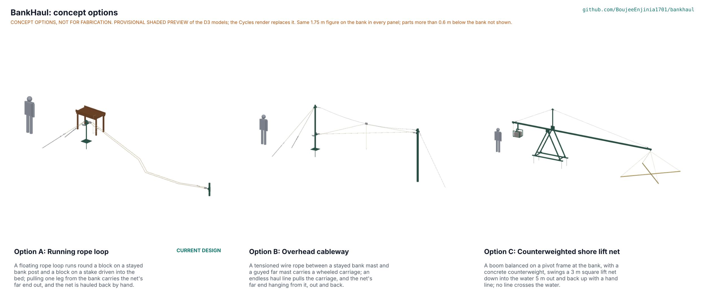

# BankHaul concept options

Recommendation: option A, the running rope loop (the current design), scores 178 of 220 against 149 for option C, the counterweighted shore lift net, and 139 for option B, the overhead cableway; A leads the runner-up by 16 %, so one option was recommended, and Amish chose it on 2026-10-25 (BKH-DDR-004, BKH-DEC-001 O-1). All three options are modelled to detail level D3 in `cad/src/model.py` ("Detail every option", Amish, 2026-10-24). Method: STANDARDS section 21.

*Figure 1. The three options from their D3 models, each with a 1.75 m figure. The picture in the repo is a provisional shaded preview (`cad/src/options_preview.py`); the coordinator replaces it with the Cycles render from `python .kit/options.py`.*

## The options

### Option A: running rope loop (current design)

A floating rope loop runs round a swivel block on a stayed steel post on the bank and a second block on a steel stake driven into the bed 30 m out; pulling one leg from the bank carries the net's far end out on a swivel ring, and the net is hauled back by hand onto a table at least 5 m from the water. Its loads are small because the loop is slack: the peak pull is about 200 N, the far end sees at most 1.4 kN through the weak links, and the bank 3 kN. It reuses the fisher's own gillnet. Risks: the far stake must be driven from a boat, the most exposed job; the loop crosses the water, where boats and debris meet it; screw anchors and the stake need soft but not liquid soils. Needs from a partner: a trial site, the nets used there, a boat crew and the bed's shear strength.

### Option B: overhead cableway

An 8 mm galvanised wire rope is tensioned between a 2.6 m stayed mast on the bank and a 3.0 m mast driven into the bed and guyed to a screw anchor beyond it. A two-wheel carriage runs on the cable, hauled out and back by an endless 8 mm line round a block on each mast; the net's far end hangs from the carriage on a drop line with a weak link. The net and its far end never drag on the bed. Risks: a tensioned span multiplies the net-end pull: 690 N at mid-span of a 30 m cable sagging 1.0 m puts about 5.4 kN into the cable and 10 kN into the far guy, more than a screw anchor holds in soft mud (STEM B2, fails with a fix proposed); two masts and a guy anchor must be placed in the water; the cable's height is fixed while the water level moves. Needs from a partner: a firmer bed or a heavier anchor, and boat time.

### Option C: counterweighted shore lift net

A boom 11 m long balances on a steel pivot frame 3 m back from the water's edge, stiffened by a king post and two wire stays and balanced by six concrete blocks in a basket under its short arm. A 3 m square lift net hangs on crossed bamboo spreaders from the tip, 5 m beyond the edge; the fisher lowers it into the water and raises it with a hand line from the counterweight end, 6 m from the water. Nothing is placed in the water and no line crosses it. Risks: it changes the fishing method from gillnets to a lift net that reaches only 5 m out (STEM C3); the balance is a compromise between the loaded and the empty net, and with six blocks the loaded net needs about 390 N on the hand line (STEM C1, fails with a fix proposed); a 394 kg structure with a swinging boom has pinch and crush points. Needs from a partner: fishers who use or would use lift nets, and a bank where fish come close in.

## First-order numbers

Table 1. Options compared for the 30 m design case. Masses and part counts from the D3 models (`cad/fidelity.json`, 7 m picture layout; design case from `python cad/src/model.py`); costs of B and C are first-order estimates from the same unit prices as `bom/bom.csv`.

| Quantity | Option A | Option B | Option C |
| --- | --- | --- | --- |
| Estimated parts cost (USD) | 399 (priced BOM) | About 600 (estimate: two masts, 40 m of wire, three anchors, carriage) | About 400 (estimate: 11 m boom, pivot frame, counterweight) |
| Mass of the D3 model (kg) | 102.0 (picture layout); 107.7 (design case) | 201.5; 213.1 | 394.0 (with 115 kg of concrete) |
| Reach from the bank | 30 m (rope for 50 m) | 30 m | 5 m |
| Peak effort | About 200 N to haul | About 200 N to haul the net; the carriage line about 50 N | About 390 N to raise a loaded net (fix proposed) |
| Largest structural load | 3 kN at the bank, 1.4 kN at the far end | About 5.4 kN in the cable, 10 kN in the far guy | About 2.7 kN on the pivot |
| Parts in the D3 model (made or bought, fasteners, welds) | 160 (69, 76, 15) | 175 (73, 82, 20) | 127 (59, 34, 34) |
| Parts placed in the water | One stake | One mast and one guy anchor | None |
| STEM check | Open on field data; four fixes made (D-S1 to D-S4) | B2 fails with a fix proposed (guy anchor) | C1 fails with a fix proposed (balance); C3 changes the fishing method |

## Scoring

Table 2. Weighted scoring (weights: High UR 3, Medium 2, Low 1; scores 1 to 5).

| Criterion | Source | Weight | A | B | C | Reason |
| --- | --- | --- | --- | --- | --- | --- |
| Never wade | UR-001 | 3 | 4 | 4 | 5 | C has nothing in the water; A and B need one placement from a boat |
| Use our nets | UR-002 | 3 | 5 | 4 | 1 | A sets the fisher's gillnet; B hangs it from a carriage; C needs a lift net |
| Stay back from the edge | UR-003 | 3 | 4 | 4 | 4 | 5 m in A and B, 6 m at C's counterweight |
| One person can haul | UR-004 | 3 | 4 | 4 | 2 | About 200 N in A and B; about 390 N in C until rebalanced |
| Reach the fish | UR-005 | 2 | 5 | 4 | 1 | A reaches 50 m with the rope bought; B's tension grows with span; C reaches 5 m |
| A seized net lets go | UR-006 | 3 | 4 | 3 | 3 | Weak links in all; B multiplies the pull into its masts; C's boom is pulled down |
| Fits a fishing night | UR-007 | 2 | 4 | 4 | 5 | C lifts in a minute; A and B take about 6 minutes a cycle |
| Stays put | UR-008 | 3 | 4 | 2 | 4 | A's anchors at factor 2; B's guy anchor fails in soft mud; C carries no horizontal load |
| Lasts a season | UR-009 | 2 | 4 | 3 | 3 | B adds wire and a carriage in the splash zone; C's bamboo and net frame wear |
| Follows the shore | UR-010 | 2 | 4 | 2 | 3 | A relocates in 22 minutes and its far block moves on the pin; B's cable heights are fixed; C's frame and blocks are heavy to move |
| Affordable | UR-011 | 3 | 4 | 2 | 3 | From Table 1 |
| Made and mended locally | UR-012 | 2 | 4 | 3 | 4 | B needs wire terminations and tensioning |
| Installed without wading | UR-013 | 3 | 3 | 2 | 5 | B needs a mast and a guy anchor placed in the bed |
| Allowed where we fish | UR-014 | 2 | 3 | 3 | 4 | A and B put a line across the water; C stays on the bank |
| Cost against the value-engineering target | | 2 | 5 | 4 | 4 | All well within USD 1,800 |
| Buildable with local skills and tools | | 2 | 4 | 3 | 4 | As UR-012 |
| Safety | | 3 | 4 | 3 | 3 | B's tensioned wire can whip if it fails; C has a swinging boom and a hanging counterweight |
| Maintenance | | 1 | 4 | 3 | 3 | A: rope, splices and bushes; B adds the wire and carriage; C the pivot and net frame |
| **Weighted total** | | | **178** | **139** | **149** | |

Weighted total = sum of score x weight over the 18 criteria (maximum 220).

## Recommendation

**Option A, decided by Amish on 2026-10-25** (BKH-DEC-001 O-1, argued in BKH-DDR-004):

- **Option A** is the only option that sets the fisher's own gillnet at the reach where fish are, with loads small enough for screw anchors and a driven stake in soft ground; its weak links bound what a seized net can do. Its weakness is the one placement in the water, the far stake.
- **The runner-up's best idea, from option C**, is to lift the catch rather than drag it: in A the peak pull is set by dragging the catch and weed up the bank edge (BKH-CAL-001 B, 157 N of the 200 N). A roller or a smooth board at the bank edge would cut it; Amish decided on 2026-10-25 to add a smooth board (O-2, BOM line 18) and measure the pull with and without it in the R3 trial.

The repo carries option A, as designed before kit 1.8, with the bank-edge board added. Options B and C remain in the model at D3 as alternatives; their fixes (B2, C1) are sized on paper only.
